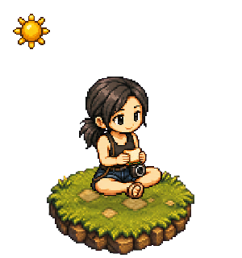
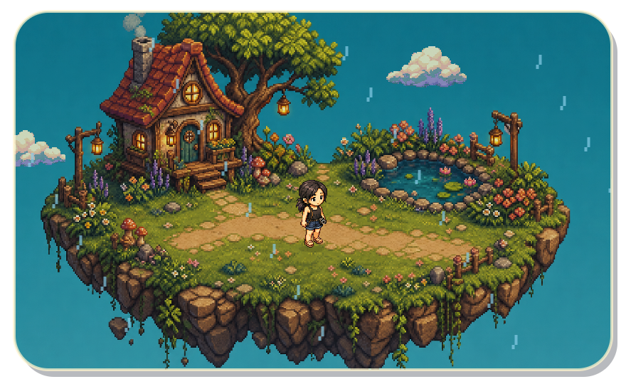

# Sophie Desktop Pet

[](https://github.com/hackermengzhi/sophie-desktop-pet/actions/workflows/build.yml)
[](https://github.com/hackermengzhi/sophie-desktop-pet/releases)
[](https://dotnet.microsoft.com/)
[](https://avaloniaui.net/)

> A tiny transparent macOS desktop companion with her own weather, daily
> routine, and expandable pixel-art island.

[简体中文](README.zh-CN.md)



## Highlights

- Transparent, frameless, always-on-top macOS desktop pet.
- Fifteen independently generated four-frame life animations: idle, walking
  right, walking left, sitting, eating, sleeping, gardening, reading, rain
  umbrella, snowman building, shivering, cooling down, backpack outings, and
  joyful jumps, and an affectionate expression.
- Every frame is held for 500 ms. A guaranteed activity cycle follows 20
  seconds of idle time with one random non-idle action.
- Approximate automatic location via [ipwho.is](https://ipwho.is/) and current
  conditions from [Open-Meteo](https://open-meteo.com/).
- Weather refreshes every 15 minutes and retries after 2 minutes on failure.
- Sophie keeps a front-facing idle pose. In clear automatic weather, cold
  conditions can make her shiver and heat can make her wipe her brow; rain and
  snow take precedence with umbrella and snowman activities. No temperature
  number is displayed: the symmetric right-side pixel thermometer uses four
  visual levels.
- Manual weather disables automatic updates until **Restore Automatic
  Weather** is selected.
- Compact mode keeps Sophie on a tiny generated turf patch instead of roaming
  across the entire desktop.
- Double-click Sophie to open or close a larger island world.
- Day/night scenes, drifting clouds, fireflies, pixel rain, and pixel snow.
- Clear daytime can also send Sophie on a tiny backpack outing, give her a
  spontaneous joyful jump, or show a sweet affectionate expression. These are
  automatic life moments, not menu actions.
- Checks the latest GitHub release at launch and hourly. A newer signed package
  is downloaded and SHA-256 verified, but installed only after a menu click.
- Self-contained Apple Silicon build; no separate .NET installation required.

## Island world



Sophie walks to an activity spot before sitting, eating, sleeping, gardening,
reading, or weather-appropriate activities. Her feet follow the island's
ground plane with restrained depth scaling so she remains visually grounded in
the scene. Sitting and snowman building play once, then hold their completed
pose instead of cycling backwards.

## Controls

| Input | Action |
| --- | --- |
| Drag | Move Sophie or the island window |
| Double-click Sophie | Open or close the island |
| Right-click | Open settings, weather controls, updates, and Quit |

Life actions are intentionally automatic and are not exposed as menu commands.

## Automatic updates

The updater accepts exactly one release asset named
`Sophie-Desktop-Pet-macOS-arm64.zip`. Before installation it verifies the
asset size, GitHub-provided SHA-256 digest, app structure, and code signature.
The previous app is restored if replacement fails. If macOS launched Sophie
through App Translocation, or the current folder is not writable, the verified
update is installed in `~/Applications` and relaunched from there.

The updater reads this public repository anonymously. It does not request,
store, embed, or log GitHub credentials.

## Build

Requirements:

- macOS 12 or newer
- .NET 10 SDK

```bash
dotnet restore SophieDesktopPet/SophieDesktopPet.csproj
dotnet build SophieDesktopPet/SophieDesktopPet.csproj -c Release
```

Create a self-contained Apple Silicon build:

```bash
dotnet publish SophieDesktopPet/SophieDesktopPet.csproj \
  -c Release \
  -r osx-arm64 \
  --self-contained true \
  -p:PublishSingleFile=true
```

The Build workflow verifies the same package but intentionally does not expose
it as an Actions artifact: GitHub would wrap the release ZIP in another ZIP.
User downloads are the direct assets on the repository Releases page.

For a production release, update `Version` in the project and push the matching
tag, such as `v1.4.1`. `release.yml` builds, signs, verifies, retains the Actions
artifact, and creates the GitHub Release with the ZIP and SHA-256 file.

## Project layout

```text
SophieDesktopPet/
  App.cs                  Avalonia application and theme
  PetWindow.cs            window, input, schedule, and activity transitions
  WorldControl.cs         pixel rendering, weather, island, and sprite atlas
  PetState.cs             animation rows and state definitions
  Assets/                 generated production artwork
docs/screenshots/         compact and island previews
```

## Privacy

The application does not contain analytics, advertising, accounts, or
background data collection. Network requests are limited to ipwho.is for
approximate location, Open-Meteo for current weather, and GitHub for release
checks and downloads.

Location data by [ipwho.is](https://ipwho.is/) and weather data by
[Open-Meteo](https://open-meteo.com/).

## License

The C# source code is available under the [MIT License](LICENSE).

The Sophie character likeness and generated artwork are personal project
assets and are **not** covered by the MIT License. See [NOTICE.md](NOTICE.md)
before redistributing or reusing artwork.
